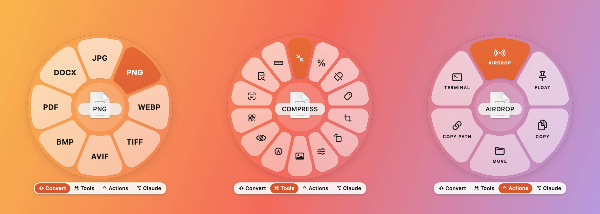
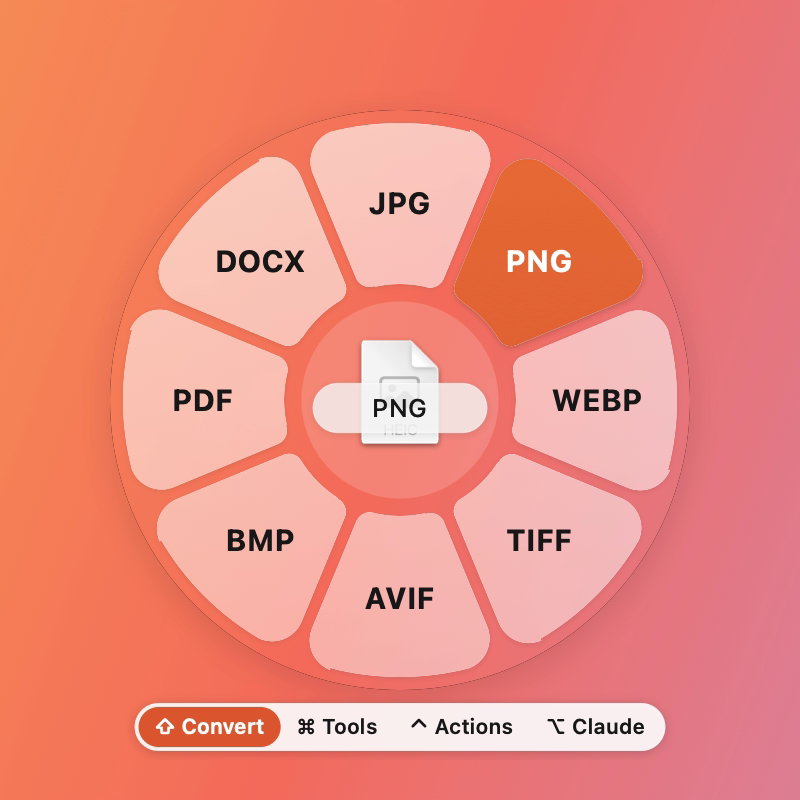
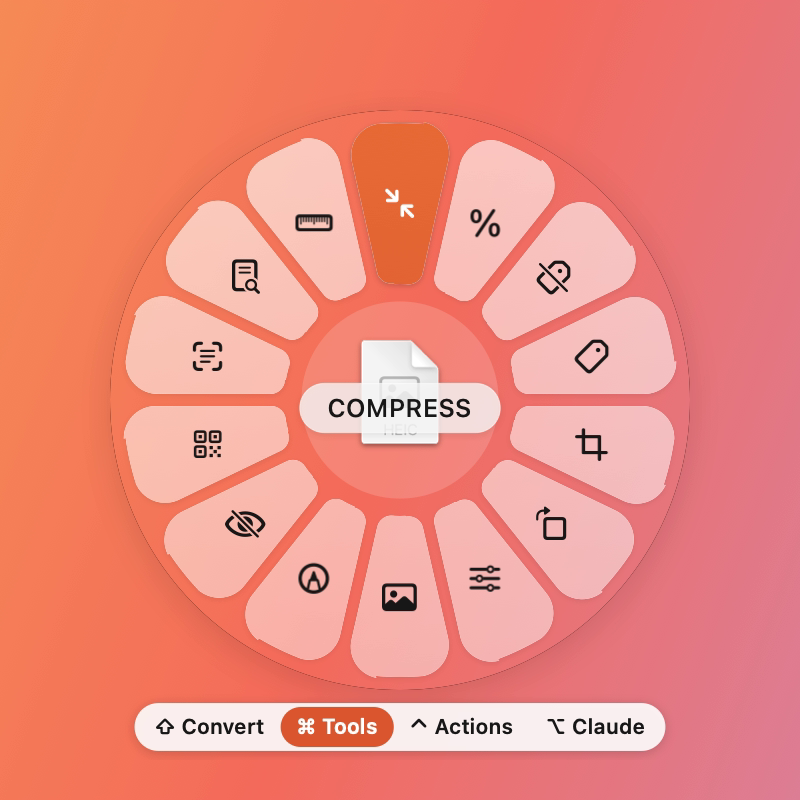

<p align="center">
  
</p>

<h1 align="center">Clementine aka Tangerine-clone</h1>

<p align="center">
  <b>The zero-click file converter for macOS.</b><br>
  Drag a file in Finder, tap a key, drop it on the wheel. Done.
</p>

<p align="center">
  
  
  
  
</p>

<p align="center">
  
</p>

Clementine is a free, open-source menu-bar app that converts and edits files right where they
are. Start dragging a file in Finder, tap a modifier key, and a glass wheel appears under the
cursor with everything that file can become. Drop it on a choice and the result is saved next
to the original. The original is never touched.

It works on **Intel and Apple silicon** Macs running **macOS 13 Ventura or later**, and
everything runs on your Mac: nothing is uploaded.

## Contents

- [Features](#features)
- [Install](#install)
- [How to use it](#how-to-use-it)
- [Supported formats](#supported-formats)
- [Engines](#engines)
- [Build from source](#build-from-source)
- [Command line](#command-line)
- [Tests](#tests)
- [Project layout](#project-layout)
- [Contributing](#contributing)
- [License](#license)

## Features

| Key | Wheel | What it does |
|---|---|---|
| ⇧ Shift | **Convert** | The file in a new format, saved next to the original. 262 conversion paths. |
| ⌘ Command | **Tools** | 34 tools, filtered to the file you dragged (see below). |
| ⌃ Control | **Actions** | AirDrop · Float · Copy · Move… · Copy Path · Open in Terminal |
| ⌥ Option | **Claude** | Ask… · Summarize · Translate… · New Chat. Opens the file in a new chat in the Claude desktop app. |

**Tools:** Compress · Shrink to %… · Fit to Size… · Strip Metadata · Metadata… (view, edit,
remove) · Crop… · Trim… · Rotate & Flip… · Edit Photo… · Add BG… · Annotate… · Redact…
(faces / text) · Collage · Create PDF · Read QR · Read Text (OCR) · Searchable PDF · Mute ·
Extract Audio · Snapshot · Frames… · Speed… · Split… · Join · Mono ⇄ Stereo · Normalize ·
Trim Silence · Bleep… · Visualizer · Image + Audio → Video · Merge · Reorder Pages… ·
Extract Text · Extract

**Batches:** drag several files and the wheel shows only what all of them can become.

**Editors:** Crop, Trim, Edit Photo (exposure, highlights, shadows, temperature, tint…), Add BG
(gradients, colours, macOS wallpapers, padding, rounded corners, shadow, aspect ratio) and
Annotate (pen, highlighter, arrows, boxes, text) open in a glass window with a live preview.

<p align="center">
  
  
</p>

## Install

### Download

1. Download **Clementine.zip** from the [latest release](../../releases/latest).
2. Unzip it and drag **Clementine.app** into your **Applications** folder.
3. The app is not notarized, so the first time, **right-click Clementine.app → Open → Open**.
   (Or run `xattr -dr com.apple.quarantine /Applications/Clementine.app` in Terminal.)
4. A clementine icon appears in the menu bar. That's the whole app.

### Permissions (both optional)

| Permission | Why | Where |
|---|---|---|
| **Accessibility** | Arrow keys, Return, 1–9 and typing on the wheel *while dragging* (Finder owns the keyboard during a drag). | System Settings → Privacy & Security → Accessibility |
| **Automation → Finder** | The **⌃⌥C** shortcut reads which files are selected in Finder. macOS asks the first time. | System Settings → Privacy & Security → Automation |

Clementine asks for Accessibility once on first launch. *Settings…* in the menu bar shows
whether it is on.

### Open at login

Menu bar → **Settings…** → *Open Clementine at login*.

## How to use it

**With a drag:** start dragging a file in Finder, tap ⇧ (or ⌘, ⌃, ⌥), and drop it on a sector.
You don't have to keep holding the key: the wheel stays open until you drop or cancel. The bar
under the wheel switches wheels by click, or by dragging over it.

**With the keyboard:** select files in Finder and press **⌃⌥C**. The wheel opens at the cursor.
On the wheel:

| Key | Action |
|---|---|
| ← → ↑ ↓ | Move between sectors |
| Return | Run the highlighted sector |
| 1–9 | Run that sector |
| Type a name | Jump to it (`cr` → Crop) |
| Tab | Next wheel |
| Esc | Close |

**From the clipboard:** menu bar → *Convert Clipboard…* turns copied files, an image or text into
a file and opens the wheel for it.

**Settings…** lets you choose which key opens which wheel, change the ⌃⌥C shortcut, show results
in Finder when a job finishes, and open at login.

### The Claude wheel

The ⌥ wheel hands the file to the [Claude desktop app](https://claude.ai/download) in a new
chat, the same way Finder's *Open With → Claude* does. Claude asks before uploading, then the
file is attached to a new conversation. For Summarize and Translate the prompt is copied to the
clipboard: press ⌘V in Claude to add it. No API key is involved. Without the Claude app,
Clementine offers the download, or claude.ai in your browser.

### Privacy

Conversions and tools run locally with built-in macOS frameworks and the engines below. The
only thing that ever leaves your Mac is a file you explicitly drop on the Claude wheel, and the
Claude app asks you before it uploads anything.

## Supported formats

`*` = input only

| Category | Formats |
|---|---|
| Images | jpg png webp heic tiff avif bmp, → pdf docx; svg* |
| Audio | mp3 m4a wav flac ogg opus aiff; wma* |
| Video | mp4 mov mkv webm gif, → mp3; avi* wmv* |
| Documents | pdf → docx pages pptx xlsx jpg png (300 dpi) epub txt md html; docx pages md txt epub html rtf ↔ each other, → pdf; rtfd* |
| Spreadsheets | xlsx ods csv tsv, → pdf; xls* |
| Slides | pptx → pdf jpg png; ppt* |
| Archives | zip tar tgz, folders → archives; rar* |
| Subtitles | srt vtt, → txt |

Scanned PDFs are OCR'd automatically on every text route. `Clementine formats` prints the live
table.

## Engines

Images, PDFs, txt / docx / html / rtf, csv / tsv and archives work with **nothing installed**
(ImageIO, PDFKit, Core Text, Vision, textutil and bsdtar are part of macOS). Other formats use
free command-line engines. The wheel tells you which one to install when you need it.

| Engine | For | Install |
|---|---|---|
| ffmpeg | audio, video, WebP, subtitles | `brew install ffmpeg` |
| pandoc | Markdown, EPUB | `brew install pandoc` |
| cwebp | WebP output | `brew install webp` |
| avifenc | AVIF output | `brew install libavif` |
| LibreOffice | XLSX, ODS, PPTX, PDF → DOCX with layout | `brew install --cask libreoffice` |
| Pages | .pages files | free on the [Mac App Store](https://apps.apple.com/app/id361309726) |

**No Homebrew?** Menu bar → *Install Engines (no Homebrew)…* (or `Scripts/get-engines.sh`)
downloads static ffmpeg, pandoc and cwebp into `~/Library/Application Support/Clementine/engine`.
Those are third-party builds (martin-riedl.de / evermeet.cx, pandoc's release page, Google's
libwebp) and are not signature-checked; engines installed with Homebrew take priority. Check
what was found with menu bar → *Engines…*.

## Build from source

Requires the Xcode Command Line Tools (`xcode-select --install`). No Xcode project; Swift
Package Manager only.

```sh
git clone https://github.com/Saadanjum0/clementine.git
cd clementine
Scripts/build-app.sh               # universal (x86_64 + arm64) dist/Clementine.app
open dist/Clementine.app
```

`Scripts/build-app.sh 1.0.0 --single` builds for the current architecture only (faster).
`swift Scripts/make-icon.swift` regenerates the app icon.

Building with Xcode 26 (Swift 6.2+) turns on Liquid Glass for the wheel on macOS 26; older
toolchains build the same app with a blurred-glass look.

## Command line

The app binary doubles as a CLI:

```sh
Clementine convert photo.heic --to jpg
Clementine tool compress clip.mp4
Clementine formats                  # the conversion table
Clementine engines                  # which engines were found
```

## Tests

```sh
swift run Clementine --selftest          # conversion graph + real conversions on generated files
swift run Clementine --selftest --quick  # skips the slow video encodes
swift run Clementine --uitest            # drives the real wheel: hover, keys, drops, batches
```

Checks that need a missing engine are reported as `skip`, never as a pass. With every engine
installed: 155 self-test checks and 50 UI checks.

Handy while developing: `--show <file> [tools|actions|claude]` opens a wheel,
`--edit <tool> <file>` opens an editor (`background`, `annotate`, `adjust`, `crop`…), and
`--render out.png` draws every wheel to a PNG.

## Project layout

| Path | What |
|---|---|
| `Sources/Clementine/DragMonitor.swift` | The gesture: watches Finder drags and modifier keys |
| `Sources/Clementine/WheelPanel.swift` | The wheel: glass panel, petals, hover, keys, progress card |
| `Sources/Clementine/Formats.swift` | The format table and what converts to what |
| `Sources/Clementine/Convert.swift` | Picks the route and engine for each conversion |
| `Sources/Clementine/Tools.swift`, `Actions.swift` | The Tools and Actions wheels |
| `Sources/Clementine/Native.swift` | Everything done with macOS frameworks (ImageIO, PDFKit, Vision, Core Image) |
| `Sources/Clementine/Engine.swift` | Finds engines and runs each job's steps |
| `Sources/Clementine/Editors.swift`, `GlassEditors.swift` | Editor windows, Settings |
| `Sources/Clementine/Claude.swift` | The Claude wheel |
| `Sources/Clementine/AppDelegate.swift` | Menu bar item, global shortcut |
| `docs/RESEARCH.md` | Notes on the gesture and engines this design is based on |

## Contributing

Issues and pull requests are welcome. Please run `swift run Clementine --selftest --quick`
and `swift run Clementine --uitest` before opening a pull request.

Not done yet: redacting video, presets, watch folders.

## License

[MIT](LICENSE).

Clementine is an independent project inspired by [Tangerine](https://tangerineformac.com/) and
is not affiliated with LEAP STUDIO. Claude is a trademark of Anthropic; Clementine is not
affiliated with Anthropic. macOS is a trademark of Apple Inc.
